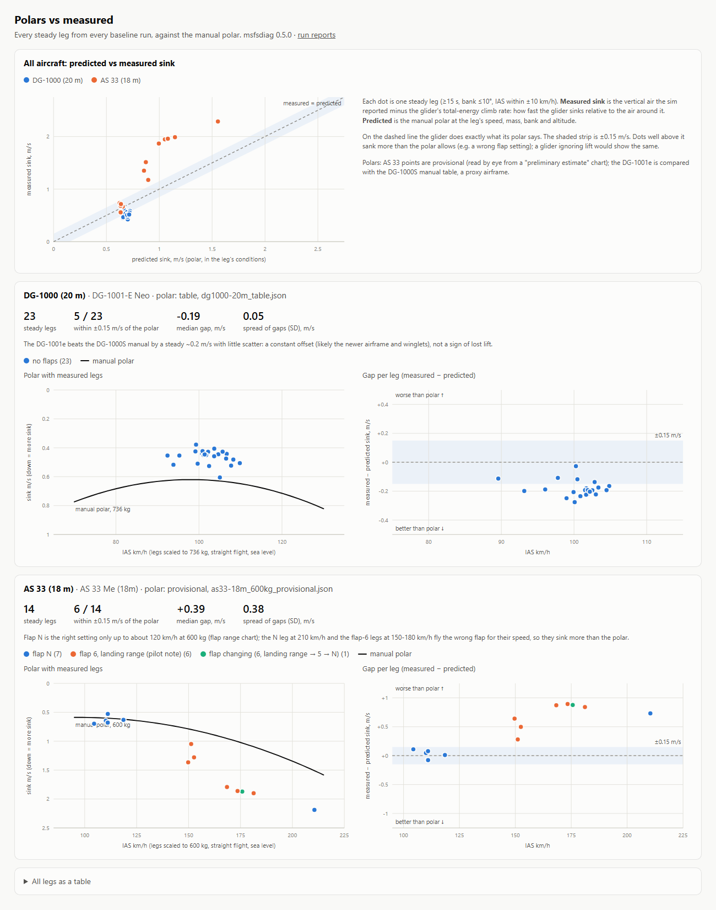
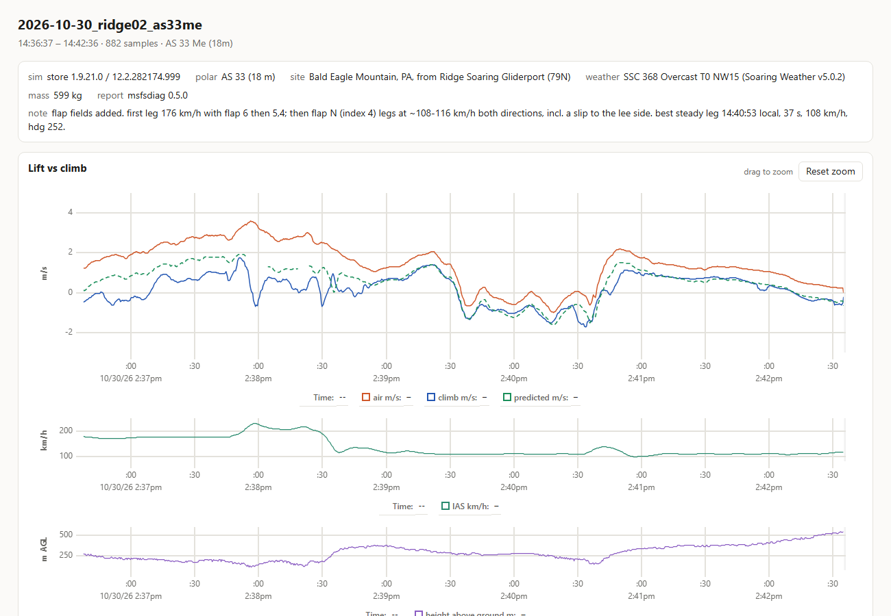

# msfs-diagnostics

Is the lift in my glider sim working? These tools answer that with data instead of feel.

They record a glider flight in MSFS 2024 over SimConnect, then compare three things moment by moment:

1. **the air**: the vertical air movement the sim reports at the aircraft (`AMBIENT WIND Y`)
2. **the glider**: its total-energy climb rate (height plus speed, so pull-ups don't count as lift)
3. **the prediction**: the air minus the glider's own sink rate from its published polar, corrected for weight, bank and altitude

If the sim's lift reaches the glider, (2) and (3) overlap. If they don't, the gap shows how much is missing and where.



## what we found

The first investigation was a report that, after SU7, thermals and ridge lift had stopped working. In MSFS 2024 (store 1.9.21.0) across Pennsylvania, Peru and India, and in ridge, cumulus and thermal lift, both gliders tested climbed exactly as their polars predict:

- **Asobo DG-1001e**: 23 legs, a steady 0.2 m/s *better* than the DG-1000S manual, spread 0.05.
- **GotFriends AS 33 Me**: within ±0.1 m/s with the right flap.

The problems traced to setup:

- **Flap lever left at 6** (landing range) at 175 km/h cost ~1 m/s.
- **West wind on a slope flown from its east side**: the lee, so sinking air.
- **The thermal visualization** disappears as you approach while the lift is still there.

Details in [design/WORKLOG.md](design/WORKLOG.md).

## examples

[examples/](examples/) has the best reports from that investigation. Each is a single HTML file with its data and charts inside; download and open, no server needed. Start with [examples/index.html](examples/index.html), or see [examples/README.md](examples/README.md) for what each one shows.



## use

```
python scripts/simconnect_probe.py --out data/raw/test.jsonl --note "what you're testing"   # record (Ctrl+C to stop)
python -m msfsdiag.analysis.report --all                                                    # build reports/
```

How to fly for clean data, mark moments, keep runs and read the reports: [doc/GUIDE.md](doc/GUIDE.md). Recording format: [doc/TELEMETRY.md](doc/TELEMETRY.md).

## setup

Windows, Python 3.11+, MSFS 2024.

```
python -m venv .venv
.venv\Scripts\activate
pip install -e .[dev,record]                 # record = SimConnect, for the recorder
copy config.example.json config.local.json   # then edit paths
python scripts/fetch_sources.py               # download reference manuals
pytest
```

`community_folder` in `config.local.json` is usually one of:

- MS Store: `%LOCALAPPDATA%\Packages\Microsoft.Limitless_8wekyb3d8bbwe\LocalCache\Packages\Community`
- Steam: `%APPDATA%\Microsoft Flight Simulator 2024\Packages\Community`

## other gliders, other sims

- **Another MSFS glider**: add a polar file to `data/polars/` (see [data/README.md](data/README.md)) with a `match_titles` entry for the sim's aircraft title, and fly. Polars from a manual's table are best; points read from a chart are recorded once and reused.
- **Another sim**: the analysis only reads the JSON Lines format in [doc/TELEMETRY.md](doc/TELEMETRY.md). A recorder for any sim that exposes position, airspeeds, altitude, bank, weight and the air mass's vertical velocity can feed it.
- **Without the air-mass value**: the technique still gives the glider's sink against its polar in still air, but you can't separate "no lift" from "lift not applied".

## contributing

Runs from other pilots, aircraft and sim builds are the most useful contribution. Record with a `--note`, then put the `.jsonl` and `.meta.json` under `data/baselines/msfs2024-<build>/<aircraft>/runs/` with `site`, `weather` and `segments` filled in (see the guide), and open a pull request. Ideas and questions go in issues.

Code changes work in phases (see [design/PLAN.md](design/PLAN.md)): discuss, implement, test, commit. Log caveats in [design/WORKLOG.md](design/WORKLOG.md) and user-facing changes in [CHANGELOG.md](CHANGELOG.md). Versions follow [semver](https://semver.org); the version lives in `src/msfsdiag/__init__.py`. AI agents: start with [AGENTS.md](AGENTS.md).

## layout

| path | contents |
|---|---|
| `src/msfsdiag/analysis/` | polars, derived values, steady legs, HTML reports |
| `src/msfsdiag/telemetry/` | recorder package (the recorder is `scripts/simconnect_probe.py` for now) |
| `scripts/` | recorder, steady-legs text view, example builder, manual fetcher |
| `data/` | polars, baselines per sim build, reference manuals catalog, raw recordings. See [data/README.md](data/README.md) |
| `examples/` | showcase reports (committed); rebuild with `scripts/build_examples.py` |
| `reports/` | generated reports (gitignored) |
| `design/` | [instructions](design/INSTRUCTIONS.md), [plan](design/PLAN.md), [worklog](design/WORKLOG.md) |
| `doc/` | [guide](doc/GUIDE.md), [telemetry format](doc/TELEMETRY.md) |

## license

MIT. Reference manuals in `data/sources/` belong to their publishers and aren't redistributed here; `fetch_sources.py` downloads them from the original hosts. The reports embed [uPlot](https://github.com/leeoniya/uPlot) (MIT), with its notice.
