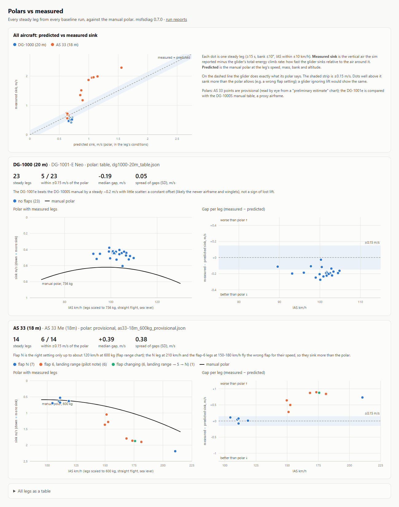
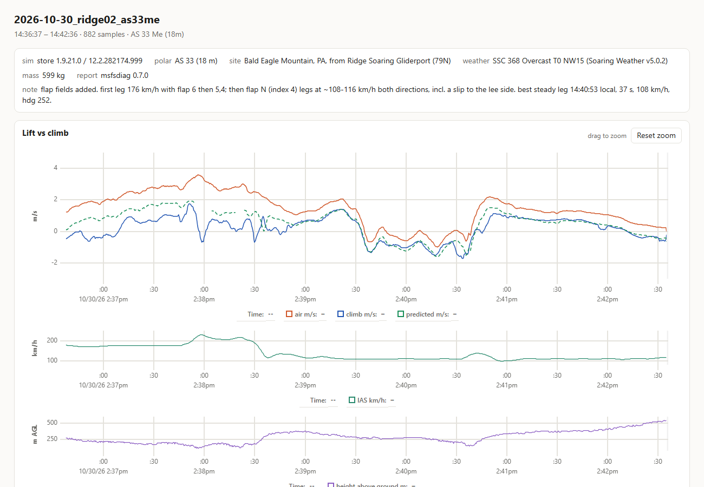
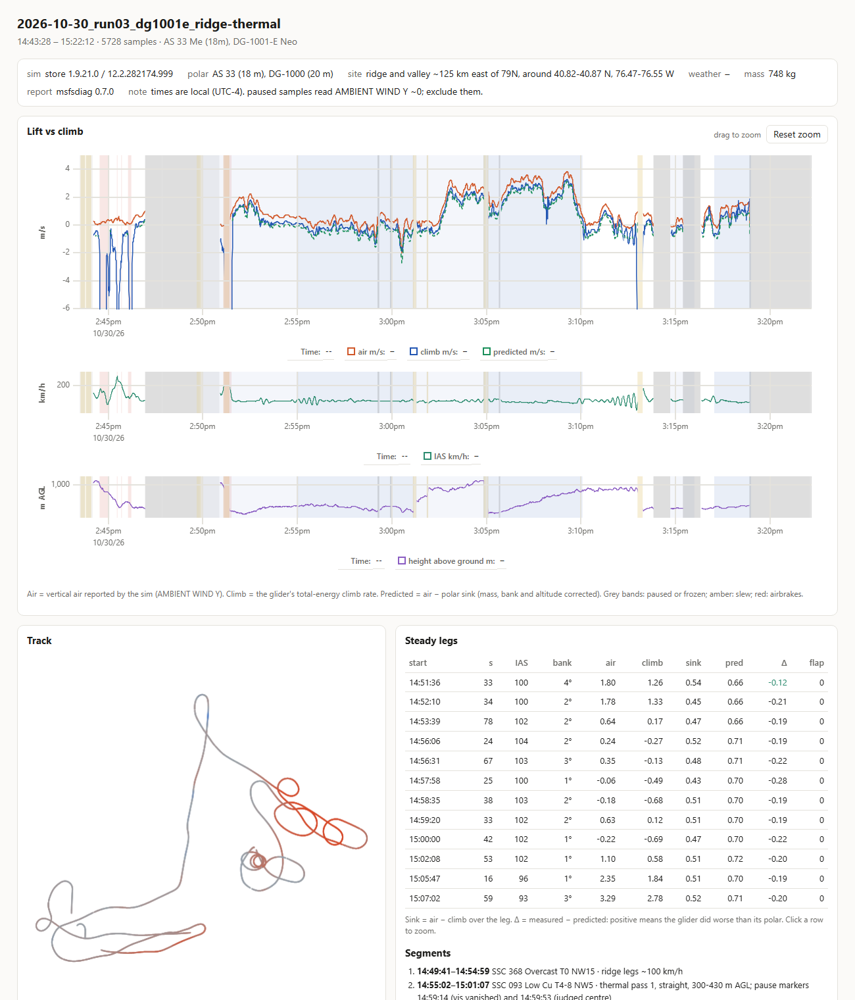
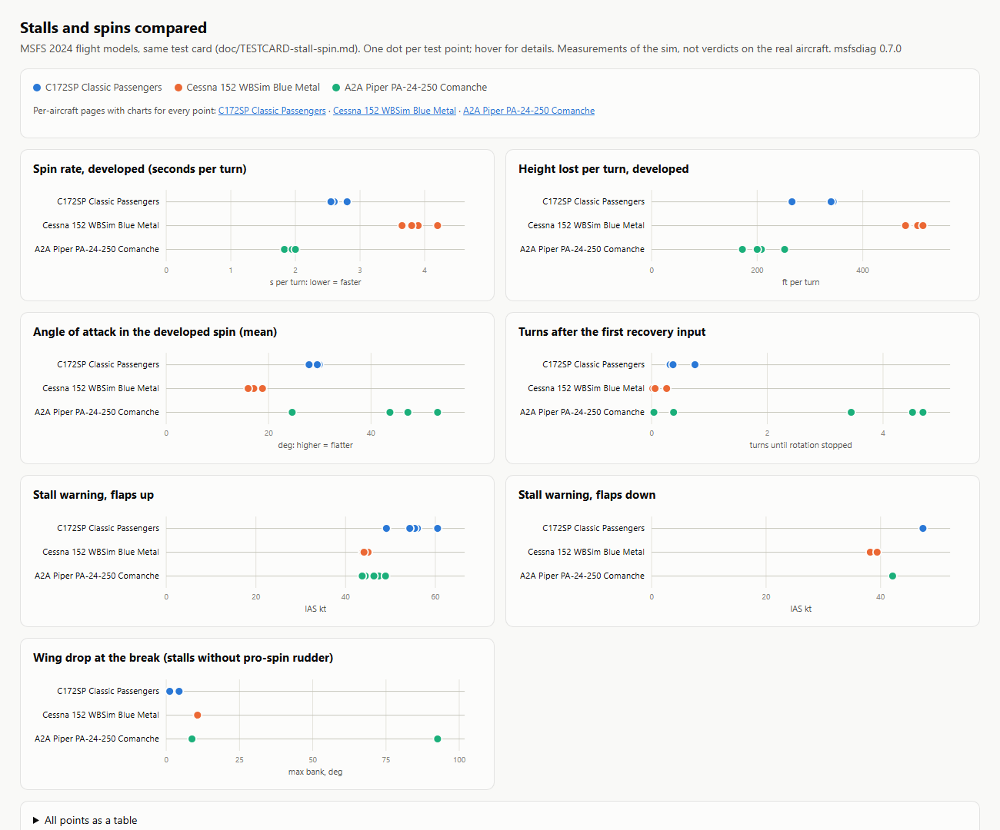
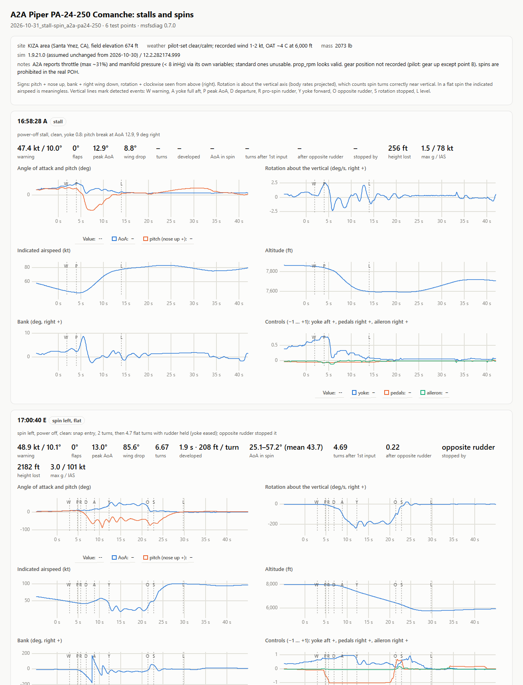

# examples

Reports from the first investigation: after MSFS 2024 SU7, do thermals and ridge lift still reach gliders?

**View them live: [coldnebo.github.io/msfs-diagnostics/examples](https://coldnebo.github.io/msfs-diagnostics/examples/)**

Each `.html` file is self-contained: the recording, the analysis and the chart library are inside. They also work offline: download the folder (or clone the repo) and open [index.html](index.html) in a browser.

Rebuild after changing the analysis: `python scripts/build_examples.py --screenshots`.

## how to read them

Every report compares three lines over time:

| line | meaning |
|---|---|
| **air** | vertical air movement the sim reports at the glider (`AMBIENT WIND Y`), m/s, up positive |
| **climb** | the glider's total-energy climb rate: height plus speed, so a pull-up isn't lift and a dive isn't sink |
| **predicted** | air minus the glider's polar sink at its speed, weight, bank and altitude |

When the glider gets the lift the sim reports, **climb and predicted overlap**. A gap means lift is going missing, or the glider is flying worse than its polar (wrong flap, airbrakes).

Steady legs (≥15 s, bank ≤10°, steady speed) are averaged into a table. **Sink** (air − climb) is how fast the glider sinks relative to the air around it. The polar says what it should be.

## the reports

### [polars.html](polars.html): polars vs measured

All steady legs from every run against the manual polars.

- **DG-1001e**: every leg sits ~0.2 m/s above (better than) the DG-1000S curve, with a spread of only 0.05 m/s. That's a constant offset from comparing against an older sister airframe, not lost lift.
- **AS 33 Me**: on its curve with flap N. The legs flown with the flap at 6 sink up to ~0.9 m/s more.

### [as33me-ridge-flaps.html](as33me-ridge-flaps.html): AS 33 Me, ridge lift and the flap lesson

Bald Eagle Mountain, PA, NW 15 kt.

- **First two minutes, flap lever at 6 (landing range) at ~175 km/h**: the glider climbs ~1 m/s less than predicted, which looks like lift not working.
- **From 14:38:30, flap N at ~110 km/h**: climb and prediction overlap, in rising air and in the lee-side sink alike.

### [dg1001e-ridge-and-thermals.html](dg1001e-ridge-and-thermals.html): DG-1001e, ridge, cumulus and thermals

40 minutes across five weather setups (segments listed on the page):

- ridge lift
- three passes through a cumulus thermal, including the one where the thermal visualization vanished ~1 km before its apparent centre (pause markers)
- a climb from 250 m to 900 m above ground at up to +3.9 m/s
- default thermals in October and June

### [dg1001e-andes-lee-side.html](dg1001e-andes-lee-side.html): Andes slope, west wind vs east wind

Near SPJE, Peru.

- **With the original west wind**, the slope flown from its east side reads −0.4 to −1.4 m/s: the lee.
- **With an east wind**, the same slope gives +0.5 to +2.1 m/s of ridge lift.

This explained the "no lift, very low" flights that started the investigation.

### [dg1001e-sim-time-vs-live-weather.html](dg1001e-sim-time-vs-live-weather.html): sim clock, real clock and Live weather

India at sim noon, 1 am in real life.

| weather | lift |
|---|---|
| SSC preset | +4 m/s |
| Live weather (the real night-time atmosphere), sim clock still at noon | almost none |
| preset re-applied | back within a minute |

The bands on the timeline mark each switch.

## stalls and spins (second project)

The same stall/spin test card ([doc/TESTCARD-stall-spin.md](../doc/TESTCARD-stall-spin.md)) flown in three aircraft over KIZA, recorded at 60 Hz. These pages show each test point's window only, thinned to 20 Hz. The raw recordings (115-172 MB per aircraft) stay with the pilot; the per-point measurements are committed in `data/baselines/.../results/`.

### [stall-spin.html](stall-spin.html): C172, C152 and Comanche compared

One dot per test point.

| | C172SP Classic | WBSim C152 | A2A Comanche 250 |
|---|---|---|---|
| developed spin | 2.5-2.8 s and 260-345 ft per turn | 3.7-4.2 s and 480-515 ft per turn | **1.8-2.0 s** and 170-250 ft per turn |
| AoA in the spin | ~30° (steep) | ~16-19°, airspeed climbing (**spiral-like**) | **44-53° (flat)**, 25° with flaps |
| what stopped it | forward yoke, within 0.3-0.75 turn | forward yoke, within 0.3 turn | **opposite rudder**: 3.5-4.7 more turns with the yoke eased and rudder held, then 0.2-0.4 after opposite rudder |
| clean stall, rudder neutral | wings-level mush | pitch break, 11° wing drop | pitch break, **wing drops of 9-92°** |

These are measurements of the sim's flight models, not verdicts on the real aircraft. Comparing them with the POHs is the next step.

### per aircraft

One card per test point: a summary, then charts of angles, rotation rate, airspeed, altitude, bank and control inputs, with the detected events marked: W warning, A yoke full aft, P peak AoA, D departure, R pro-spin rudder, Y yoke forward, O opposite rudder, S rotation stopped, L level.

- [stall-spin-asobo-c172sp-classic.html](stall-spin-asobo-c172sp-classic.html)
- [stall-spin-wbsim-c152.html](stall-spin-wbsim-c152.html)
- [stall-spin-a2a-pa24-250.html](stall-spin-a2a-pa24-250.html): on the spin cards the rotation keeps going past **Y** and stops only after **O**.

## caveats

- **AS 33 polar points are provisional.** They were read by eye from a chart the manufacturer marks "preliminary estimate".
- **The DG is compared with the DG-1000S manual**, a stand-in airframe.
- **About 2–3 samples per second.** Fine for steady legs; too coarse for gust detail.
- **Times are local (UTC−4).**
